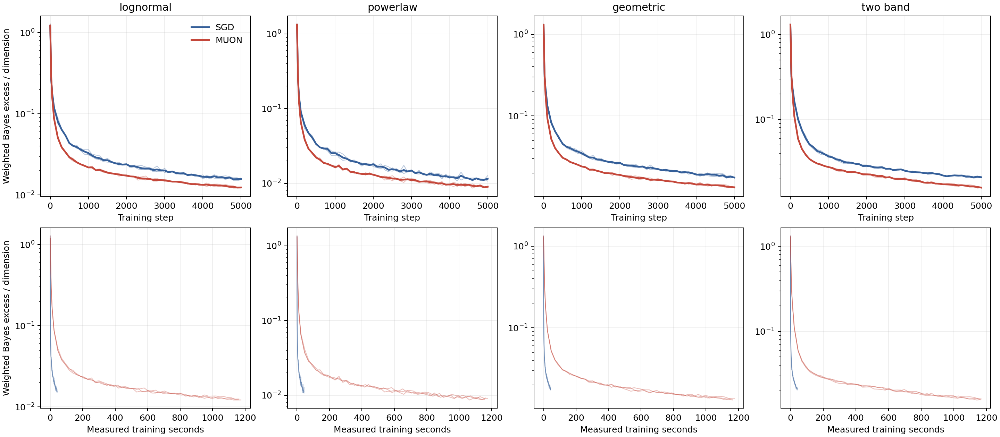

# Muon for Diffusion

Research on how gradient descent and **Simplified Muon** learn to denoise.
The current theory concerns continuous, momentum-free compact-polar flow
in a population linear denoising model with arbitrary matrix initialization.
Experiments study linear flows and nonlinear networks on centered Gaussian data.

## Results

- [Linear experiment report](results/linear/RESULTS.md): 450 paired configurations.
- [Nonlinear experiment report](results/nonlinear/analysis/RESULTS.md): 24 runs,
  four covariance families, seeds 17/43/97, 5000 updates per run.

| Gaussian covariance | SGD test excess | Simplified Muon test excess | Reduction |
|---|---:|---:|---:|
| Log-normal | 0.015673 | 0.012369 | 21.1% |
| Power law | 0.011539 | 0.009027 | 21.8% |
| Geometric | 0.017605 | 0.013352 | 24.2% |
| Two bands | 0.020961 | 0.015839 | 24.4% |

Values are three-seed means of independent-test EDM-weighted Bayes excess
per coordinate at step 5000. All 12 seed-paired final comparisons favor Muon.
This exact CPU float64 SVD implementation takes approximately 27 times as
much measured training time as SGD. Only 4/48 prescribed matched-loss targets
were matched. Thus step-budget improvements are better supported than
nonlinear matched-loss mechanism claims or compute-efficiency claims.
The targets are Gaussian; nonlinear refers to the network, not the data.
No generated-sample quality, NLL, FID, MoG, Adam, or momentum/NS5 comparison
is included in this release.



## Repository layout

```text
experiments/linear/       Population-flow simulation, frozen grid and analysis
experiments/nonlinear/    Frozen numerical implementation and fresh-run launcher
results/linear/           All published analysis tables and six figure pairs
results/nonlinear/        Independent test measurements and analysis
provenance/               Source/import hashes and provenance notes
```

## Installation

Use Python 3.12 in an isolated environment:

```bash
python -m venv .venv
# Activate .venv using the command appropriate for your shell.
python -m pip install -r requirements.txt
# Nonlinear training additionally requires PyTorch; recorded runs used CUDA 12.1:
python -m pip install torch==2.5.1 --index-url https://download.pytorch.org/whl/cu121
```

GPU availability and PyTorch installation depend on the host. The original
nonlinear run used an RTX 2000 Ada laptop GPU before migrating to an A100.
SVDs remain on CPU in this protocol.

## Reproduction

### Linear population study

```bash
python experiments/linear/validate_flow.py
python experiments/linear/run_full.py --run-name reproduction
python experiments/linear/analyze_full.py --run-dir experiments/linear/results/reproduction
```

The full run is computationally substantial. The [frozen grid](experiments/linear/full_protocol.md)
specifies numerical refinement and seeds. Published analysis tables are
included; raw trajectories are not. Regenerating trajectory-dependent figures
requires executing the simulation first.

### Nonlinear study

```bash
python experiments/nonlinear/run.py test
python experiments/nonlinear/run.py all --output runs/nonlinear_reproduction
```

The fresh-run launcher preserves the numerical implementation, selects a
separate output directory, sets `MPLBACKEND=Agg` before imports, and provides
a cross-platform worker lock. Training requires CUDA. The full command runs
the learning-rate search, 24 trainings and independent evaluation. Read the
[protocol](experiments/nonlinear/PROTOCOL.md) before launching.

The archived result measurements can be summarized without training:

```bash
python scripts/summarize_nonlinear.py
```

This writes a disposable copy and regenerated report to `runs/nonlinear_summary`.
It never overwrites the published results.

The original migration preserved platform-specific random tensors. These
large input banks and checkpoints are excluded from Git. A fresh seeded run
reproduces the experimental protocol, **not necessarily the original bitwise
random sequence or numerical results**. The stored measurements support
independent report regeneration. See [provenance](provenance/README.md).

## Attribution and reuse

The nonlinear backbone is extracted from Wang and Pehlevan's
[DiffusionLearningCurve](https://github.com/Animadversio/DiffusionLearningCurve)
at commit `94965885b5d94a8fcba0c3b6a31b895d3eb5deee`.
See [THIRD_PARTY_NOTICES.md](THIRD_PARTY_NOTICES.md) for source attribution.
This research snapshot does not assign a blanket open-source license to
third-party code. Public availability alone is not a
license grant.
