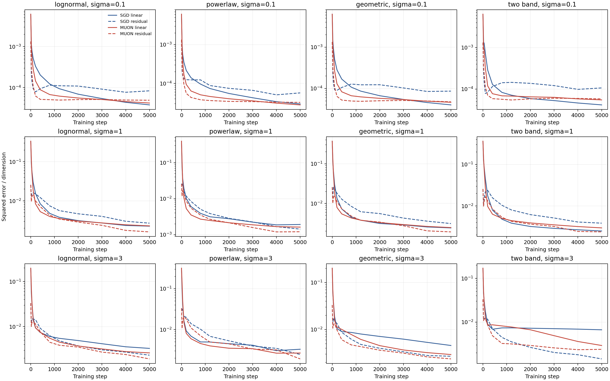

# Nonlinear Gaussian denoising results

Full 5000-step integrated test results: 24 of 24 planned runs. Paired comparisons: 12 of 12.

The table compares the prespecified final training step. Losses are integrated EDM-weighted Bayes excess per coordinate; means and standard deviations summarize available independent main seeds. Actual seed counts are recorded in final_aggregate.csv.

| Spectrum | SGD mean (SD) | Muon mean (SD) | Paired Muon/SGD ratios |
|---|---:|---:|---|
| lognormal | 0.015673 (0.000449) | 0.0123687 (0.00017) | 0.7679, 0.8114, 0.7893 |
| powerlaw | 0.0115388 (0.00103) | 0.00902682 (0.000208) | 0.7167, 0.858, 0.7842 |
| geometric | 0.0176052 (0.000125) | 0.0133517 (0.000251) | 0.7692, 0.7687, 0.7375 |
| two_band | 0.0209607 (0.00036) | 0.015839 (0.000205) | 0.7638, 0.7662, 0.7374 |

Validation-selected matched checkpoint pairs: 4 of 48 requested targets. Unmatched targets remain explicitly recorded. Selection used no test results.

Matching integrated EDM excess does not match the conditional loss at each fixed noise level. The matched comparison CSV therefore reports conditional Bayes excess, absolute high- and low-spectrum fitted-linear errors, their fit-noise estimates, and nonlinear residuals. A smaller high-spectrum fraction alone is not evidence of a smaller absolute low-spectrum error.

Largest held-out decomposition identity discrepancy: 3.86e-16.

Exact-SVD Muon and SGD have different wall-clock costs; both step and measured-training-time curves are provided. This constant-step finite-budget study need not reach the limiting optimum. Search budgets are comparable but adaptively used candidate counts can differ. Three seeds support descriptive comparisons, not a universal optimizer claim.

Data: [final aggregate](final_aggregate.csv), [paired final comparison](paired_final_comparison.csv), [validation-selected matched comparison](matched_validation_selected_test_comparison.csv), [directional first observed hits](directional_first_observed_half_error.csv).
